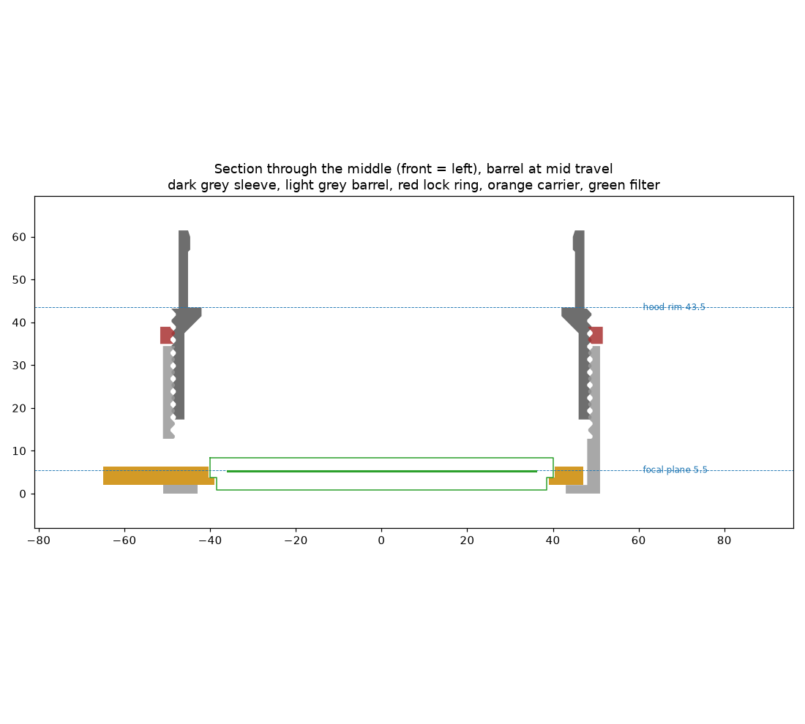

# Grind size camera stand

A printed stand that fits over the hood of the R6 II + RF 100mm F2.8L Macro and
holds a 77mm UV filter covered in coffee grounds at the lens's minimum focus
distance (1.42x, 4.22 µm per pixel). The open bottom points at an evenly lit
white surface, which is the backlight. No hardware: every part is printed.

**To print, open `grind_stand.3mf` in Bambu Studio.** It's a ready project for
the A1 with black PETG and the settings below. Plate 2 is a part that hasn't
changed since an earlier print; skip it if you already have one.

| Plate | Parts | Time | PETG |
|---|---|---|---|
| 1 | sleeve + barrel + lock ring | 2 h 47 min | 66 g |
| 2 | filter carrier (unchanged) | 19 min | 8 g |

Times and weights are from Bambu Studio 02.09.01.70's own slicer, which slices
both plates with no warnings and no supports. That CLI slice applies the
project's settings however the file lists them, so it doesn't prove the app
keeps them: the app rebuilds each preset from the stock one and keeps only the
keys named in `different_settings_to_system`, which `export_3mf.py` writes and
checks. If the app ever shows 0.20 mm layers and grid infill, that list is
missing.

## How it works



- The **sleeve** goes over the hood. The hood's front edge seats on a ledge,
  which keeps everything square to the lens, and 12 slotted fingers with a
  small lip grip the hood.
- Below the ledge, the sleeve is a tube with a coarse thread (3 mm per turn).
  The **barrel** screws onto it with an ordinary right-hand thread: seen from
  below, clockwise raises the glass toward the lens. It moves 4 mm either way
  from the middle, 2.7 turns in all, and each turn moves the glass 3 mm, so a
  twelfth of a turn is 0.25 mm.
- The **lock ring** runs down the tube against the top of the barrel. Snugging
  it stops the barrel turning, and it always pushes the thread's play to the
  same side, so the glass stays square.
- The filter sits front side up in the **carrier**, its male thread down through
  the hole and its shoulder on the ledge, so the filter's rim walls in the
  grounds. The carrier slides in through the barrel's slot a few mm high, then
  drops onto the ring at the bottom of the barrel.
- Leave the lens at minimum focus with the SA control ring at 0, with the AF/MF
  switch on MF, and focus only with the barrel. The scale then stays the same
  from session to session.
- Keep light from reaching the carrier slot. Light coming in through the slot
  lights the grounds from above and turns their black silhouettes gray.

The focal plane is somewhere between 34 and 40 mm below the hood's front edge.
The first stand put the glass at 33 mm, which was too close, and the second
could only come up to 40.5 mm, which was too far. This one centers on 38 mm and
covers 34-42.

## After printing

- **Snap out the 18 thin ribs in the barrel's slot** with pliers and clean up
  the stubs with a knife. They're there because the wall above the slot is a
  half circle held only at its ends, which can't print as a bridge.

## Setup

1. Run the lock ring up the sleeve's tube to the collar, then screw the barrel
   on about halfway.
2. Sprinkle a small pinch of grounds on the filter and tap it so they spread
   out into one layer with gaps between particles. Grounds piled on each other
   can't be measured.
3. Slide the carrier in and push the sleeve onto the hood until the hood seats
   on the ledge.
4. In magnified live view, turn the barrel until the grounds are sharp, then
   run the lock ring down against the barrel.
5. Photograph a stage micrometer or a coin to check the µm-per-pixel scale, and
   take one frame of the empty glass to correct for uneven backlight.

Use f/8. At 1.4x, f/2.8 leaves only about 0.04 mm in focus.

## Print settings

On top of Bambu's 0.20mm Standard @BBL A1 process and Generic PETG profile.
Each one is explained in `export_3mf.py`:

- Textured PEI plate, bed 70 °C (Overture PETG's range), retraction 1.0 mm
- Precise outer wall, elephant foot compensation 0.15 mm, Arachne walls, so the
  hood collar, filter pocket and threads come out at their modeled size
- 0.24 mm layers, 2 walls, 3 top and bottom layers, 10% gyroid infill. The
  stand only carries a filter, so it's built light: every wall is 2-3 mm thick
- Thick bridges, no supports, no brim (every part has a wide flat base)

## Rebuilding

Every dimension is a named constant at the top of `build_stand.py`. From the
repo root, run:

```
.venv/bin/python grindSize/stand/build_stand.py
```

It writes `grind_stand.3mf` and `preview.png`, and stops if any part has an
unsupported overhang steeper than 50 degrees (other than the slot's intended
bridge) or isn't watertight. The venv needs `manifold3d`,
`trimesh`, `shapely`, `lxml` and `matplotlib`.

## Guesses to check

`FILTER_THREAD_H` (3 mm) and `GLASS_ABOVE_SHOULDER` (1.5 mm) are guesses about
the Kenko filter. `HOOD_TO_FOCUS` (38 mm) is bracketed by the first two
stands. The barrel's ±4 mm of travel covers all three being a little off.
