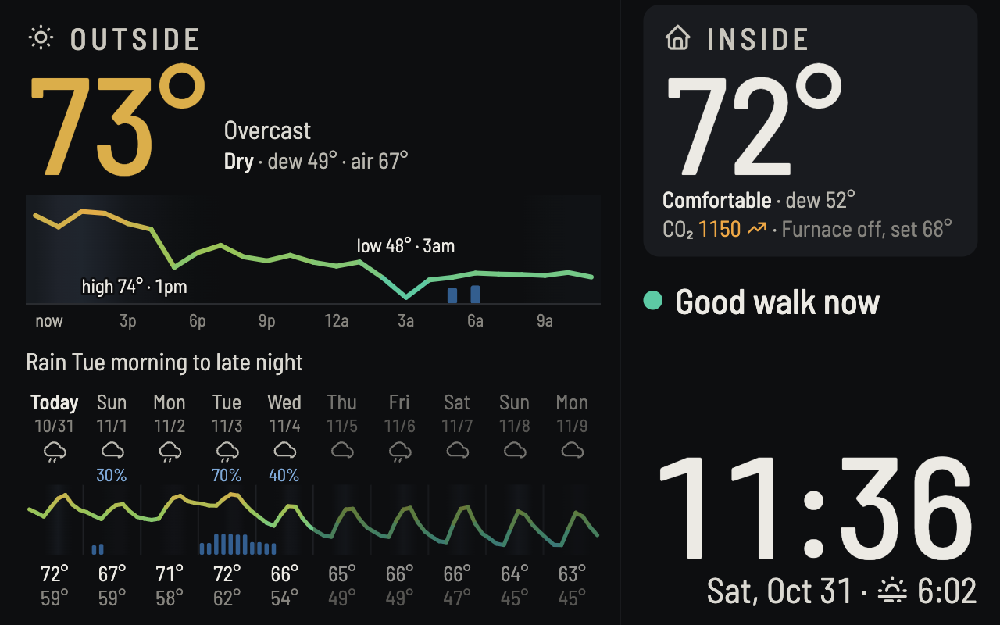

Weather Station - 2026 - Always-on living room display of the time, outdoor weather, forecast and indoor air.

The page on the living room tablet, viewed from a couch about 10 ft away. [weather-station-android](https://github.com/andrewmaxwell/weather-station-android) (private) shows it full-screen and passes in the Aranet4 and Sensi readings; that repo covers the app and the tablet.

- `?demo` makes up the indoor readings.
- `?lat=..&lon=..` overrides the location, which defaults to 38.8, -90.4. It's rounded to about 6 miles because junk is public.
- [features.html](features.html) is a feature list to share.

## Files

- `main.js`: loads the data and renders everything.
- `charts.js`: the 24-hour and 10-day charts.
- `advice.js`: the action lines.
- `week.js`: the line of words over the 10 days.
- `indoor.js`: indoor dew point.
- `constants.js`: weather codes and thresholds used in more than one file.
- `scoreForecasts.py`: scores forecast sources against airport readings.
- `../comfort/js/`: UTCI feels-like, Open-Meteo fetching, weather words and icons, and walk scores, imported directly so there's one tested copy.

Tests: `node --test weatherStation/test/*.test.js`.

## Design

It answers five questions at a glance: what time is it, how does it feel outside, should the windows be open, is it a good time for a walk, and what's coming.

- **Words first, numbers underneath.** "Open windows till 10pm" beats three numbers to compare.
- **From the couch**, the big numbers, the date and the OUTSIDE and INSIDE labels read easily, and little else does. Anything meant for the couch is at least the date's size (22rem).
- **Color means something.** One temperature scale, green, amber and red for advice, and neutral for the rest.
- **Dark and calm.** No animation, and warnings only take up space when they apply.
- **One column per place.** Outside is on the left, reading down from now to today to this week. The house is on the right, with the actions under it and the clock in the corner.
- **Rain chances under 30% stay off the charts**, and days 6 to 10 are fainter because they're less certain.

## Temperatures

- **Outside now and the 24 hours:** feels-like (UTCI in the shade), with the raw temperature marked "air".
- **Inside:** the actual temperature, from the thermostat so it's central and out of the sun, or from the Aranet4 without it. A feels-like model stayed within a degree or two and didn't match the thermostat.
- **Dew point:** from the Aranet4, since moisture is close to the same across the house.
- **The 10 days:** air temperature, because UTCI can sit 20° under the air on a breezy night, which read as a freeze that wasn't coming.
- **Freezing:** either line turns icy white where the air is at or below 32°.

## Actions

Two lines at most, ranked safety, then the house, then the walk. Long window lines wrap onto two lines, and there's room for one of those beside any other.

- **Safety**, in the next 12 hours: freezing rain, storms, gusts of 45+ mph. Also outdoor AQI of 151+ right now.
- **Open windows** when the air is between the thermostat's setpoints (68° and 80° without the Sensi), the dew point is 60° or less, AQI is 100 or less, rain chance is under 40%, it lasts at least 2 hours, and the house would end up about as close to the 75° ideal, or CO₂ is 1,000+. If the AC or furnace is running, it says to turn that off.
- **Open windows at 2pm** when the house is more than 3° from ideal and better air is coming in the next 12 hours.
- **Close the windows** for up to 3 hours after those conditions end.
- **Air out the room** at CO₂ of 1,200+, unless outdoor AQI is over 100.
- **Walk**: comfort's score now, or else the best time later today or tomorrow.

NWS alerts are left out on purpose, since they already reach Andrew's phone.

## The week line

One line over the 10 days, with at most two things in the order they happen, like "Rain early Sun morning · Colder Mon, highs in the 60s".

- **Rain, snow or storms**: the next spell in the first 5 days, from hours at 40%+. Gaps under 6 hours are merged, and a lone hour under 60% is ignored.
- **Temperature**: the biggest day-to-day change in the high over the next week, if it's 10°+ ("Much" at 20°+).
- **Freeze**: the first drop to 32°, unless it froze in the last day.
- **Never cut off**: the page measures the line and shortens the longest clause until it fits.

## Forecast sources

Scored on 2026-10-31 with `scoreForecasts.py`, against Lambert's hourly readings from Sep 1 to Oct 31. It's worth rerunning in winter.

| Forecast made | Air: default | Air: National Blend | Dew point: default | Dew point: National Blend |
|---|---|---|---|---|
| Latest run | 1.2° | 1.8° | 1.8° | 1.7° |
| 1 day ahead | 2.1° | 1.9° | 4.1° | 1.9° |
| 2 days ahead | 3.7° | 2.1° | 5.5° | 2.2° |
| 3 days ahead | 3.9° | 2.4° | 5.8° | 2.6° |
| 5 days ahead | 5.2° | 3.6° | 7.0° | 3.9° |
| 7 days ahead | 7.4° | 5.6° | 7.9° | 5.1° |

- **National Blend**: the 10 days' temperatures, freezing color, and the week line's highs and freeze, from a second request. If it fails, they use the default.
- **Open-Meteo's default**: everything else, including rain. It's better for right now, and the Blend has no soil temperature or sunlight past about 2 days, so it can't drive feels-like.
- **Not done**: correcting with an hour-old airport reading only took "now" from 1.2° to about 0.9°, and averaging the Blend, ECMWF and GFS barely beat the Blend.
- **Rain couldn't be scored**, because every model returned identical chances in that history.

## Staying current

- **Stale data** fades, and its heading says how old it is in amber: after 30 minutes for the forecast and 5 for the Aranet4. Thermostat data is dropped after 5 minutes, so advice doesn't rest on an old setpoint.
- **Outages**: the last good forecast is saved and shown on load. Failed fetches retry after 1, 2 and 5 minutes, then every 10.
- **Updates**: each deploy writes `version.txt`, naming the Git trees of `weatherStation/` and `comfort/js/`. The page checks it every minute and reloads when it changes. A push that stops the page's code from running can't fix itself this way, but the app's 3am reload recovers it.
